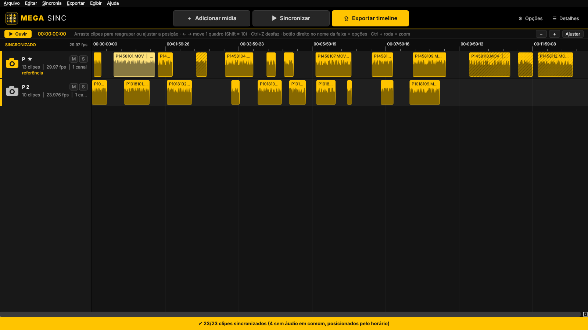

# Mega Sinc

Sincronização automática de **múltiplas câmeras e gravadores de áudio** pelo som —
no estilo do PluralEyes e do Syncaila. Roda em **macOS** (Apple Silicon e Intel) e **Windows**.

Fluxo em três passos — **＋ Adicionar mídia → ▶ Sincronizar → ⇪ Exportar timeline** — com
timeline visual: cada câmera/gravador é uma faixa, cada clipe mostra a forma de onda e o
progresso da preparação, e o próximo passo fica destacado em amarelo.

Arraste as pastas do job, clique em **Sincronizar** e exporte a timeline pronta para
**Premiere Pro**, **Final Cut Pro** ou **DaVinci Resolve** — ou gere novos vídeos já com o
áudio do gravador.



## Recursos

- **Agrupamento automático** dos arquivos por aparelho (pasta + prefixo do nome:
  `CAM_A_0001.MOV`, `ZOOM0003.WAV`, `GX010123.MP4`…). Corrija arrastando clipes entre faixas.
- **Sincronização em duas etapas**
  1. *Grosseira:* envelope de ataques em 5 bandas a 100 Hz + correlação cruzada via FFT —
     robusta a microfones diferentes, EQ, ruído e reverberação; arquivos de horas em segundos.
  2. *Fina:* GCC-PHAT sobre o áudio bruto com integração em blocos — precisão abaixo de 1 ms.
- **Detecção de drift** (clock dos aparelhos) em ppm e **correção**: a timeline pode seguir
  o relógio das câmeras e os WAVs do gravador são esticados com precisão de < 0,01 ppm.
- Resolve **vários clipes por câmera**, gravadores divididos em vários arquivos, clipes que
  só se sobrepõem a outra câmera (a ligação é feita pelo melhor caminho — árvore de máxima
  confiança + mínimos quadrados).
- **Falhas em vermelho**: tudo que não sincronizou ou deu erro fica destacado na lista, na
  timeline (faixa "✖ Não sincronizados") e na barra de status.
- **Exportação**
  - FCPXML 1.8–1.11 (Final Cut Pro / DaVinci Resolve) — áudio com precisão de amostra;
  - XML FCP7/xmeml (Premiere Pro / DaVinci Resolve) — câmeras em trilhas separadas,
    áudio vinculado;
  - vídeos `.mov` com o áudio do gravador sincronizado (imagem sem recodificar,
    opcionalmente mantendo o áudio da câmera);
  - WAVs com drift corrigido; relatórios CSV/JSON.
- **Duas ou mais câmeras sem gravador**: o horário de gravação de cada câmera (metadado do
  arquivo) é usado para descartar correspondências falsas, fazer uma busca guiada em janela
  estreita e posicionar grupos de clipes que só se sobrepõem entre si. Clipes sem nenhum áudio
  em comum ficam listrados, no lugar indicado pelo horário.
- **Player para conferir de ouvido**: ▶ Ouvir (ou barra de espaço) toca a timeline
  mixando todas as faixas; botões **M** (mudo) e **S** (solo) em cada faixa; clique na régua
  para posicionar. Microfones fora de sincronia soam com eco — sincronizados, somem.
- **Ajuste manual**: depois de sincronizar, arraste clipes na horizontal (encaixa no quadro),
  solte um clipe vermelho numa faixa para posicioná-lo à mão, use ← → para mover 1 quadro
  (Shift = 10) e Ctrl+Z para desfazer.
- **Sincronizar por timecode**: modos *Áudio*, *Somente timecode* e *Áudio + timecode*
  (o timecode posiciona o que o áudio não conseguiu, se estiver coerente com o áudio).
- **Canal de análise por faixa**: botão direito no nome da faixa → *Canal de áudio para
  análise* (ex.: lapela só no canal 2 da câmera).
- **Exportar multicâmera**: clipe multicâmera em FCPXML para Final Cut Pro e DaVinci Resolve
  (cada câmera é um ângulo, áudio do gravador); para o Premiere, a sequência com uma câmera
  por trilha vira multicâmera com *Multicâmera › Ativar*. Opção de silenciar o áudio das
  câmeras.
- Timecode embutido (MOV/MXF) e BWF são respeitados nos XMLs.
- Projetos salvos em `.megasinc`. Cache de análise: re-sincronizar é instantâneo.

## Usar a partir do código-fonte

Requisitos: Python 3.10+ e FFmpeg (no Mac: `brew install ffmpeg`; no Windows:
`winget install Gyan.FFmpeg`). Se não houver FFmpeg no sistema, o pacote `imageio-ffmpeg`
fornece um.

```bash
pip install -r requirements.txt
```

```bash
python run.py
```

## Gerar o aplicativo (.app / .exe)

**macOS** — gera `dist/Mega Sinc.app` e um `.dmg`:

```bash
bash packaging/build_mac.sh
```

**Windows** (PowerShell) — gera `dist\MegaSinc\MegaSinc.exe`, um `.zip` portátil e, se o
[Inno Setup 6](https://jrsoftware.org/isinfo.php) estiver instalado, o instalador
`MegaSinc-Setup-x.y.z.exe`:

```powershell
powershell -ExecutionPolicy Bypass -File packaging\build_windows.ps1
```

O PyInstaller não faz build cruzado: o `.app` precisa ser gerado num Mac e o `.exe` num
Windows. Para não depender disso, o repositório traz um workflow do **GitHub Actions**
(`.github/workflows/build.yml`) que roda os testes e gera **DMG Apple Silicon, DMG Intel e
instalador/ZIP do Windows** a cada push na `main` e publica tudo na Release da versão
atual (`v` + `__version__` de `megasinc/__init__.py`). Para lançar uma versão nova, aumente
o `__version__`.

> **macOS:** o app sai com assinatura ad-hoc. Na primeira vez, clique com o botão direito →
> *Abrir* (ou rode `xattr -dr com.apple.quarantine "/Applications/Mega Sinc.app"`). Para
> distribuir sem avisos é preciso uma conta Apple Developer (Developer ID + notarização).
>
> **Windows:** sem certificado de assinatura de código, o SmartScreen mostra um aviso
> ("Mais informações → Executar assim mesmo").

## Como usar

1. Arraste para a janela as pastas/arquivos de todas as câmeras e gravadores.
2. Confira as faixas (cada uma = um aparelho). Botão direito no gravador principal →
   **Definir como referência** (opcional — por padrão é o gravador de áudio mais longo).
3. **Sincronizar**.
4. **Exportar**:
   - Premiere Pro: *XML* → no Premiere, *Arquivo → Importar*.
   - Final Cut Pro: *FCPXML* → *Arquivo → Importar → XML*.
   - DaVinci Resolve: qualquer um → *File → Import → Timeline*.
   - Ou *Vídeos com áudio do gravador* para ter arquivos novos já sincronizados.

Para gravações longas (> 10 min) ative **Corrigir drift do áudio nos XMLs**.

### Linha de comando

```bash
python run.py sync /pasta/do/job --fcpxml job.fcpxml --xml job.xml --csv job.csv
```

```bash
python run.py sync --track "Cam A" a1.mov a2.mov --track Zoom zoom.wav --reference Zoom --drift-fix ./wav_corrigidos --xml job.xml
```

No Windows empacotado, use `megasinc-cli.exe` com os mesmos argumentos. Veja todas as
opções com `python run.py sync --help`.

## Estrutura

| Caminho | Conteúdo |
|---|---|
| `megasinc/media.py` | localização do FFmpeg, leitura de metadados, extração de áudio, timecode |
| `megasinc/analysis.py` | features de onset, correlação grosseira, GCC-PHAT, drift |
| `megasinc/engine.py` | grafo de correspondências, árvore de confiança, mínimos quadrados |
| `megasinc/project.py` | projeto, faixas, clipes, agrupamento automático |
| `megasinc/timeline.py` | montagem da timeline (faixas, sub-faixas, posições) |
| `megasinc/export/` | FCPXML, XML do Premiere, CSV/JSON, mídia com áudio substituído, drift |
| `megasinc/gui/` | interface (PySide6/Qt), tema escuro + amarelo |
| `packaging/` | spec do PyInstaller, scripts de build, instalador, ícones |
| `tests/` | testes de ponta a ponta com mídia sintética (`pytest`) |

## Testes

```bash
pip install -r requirements-dev.txt
```

```bash
pytest -q
```

Os testes geram câmeras e gravadores sintéticos com defasagens conhecidas, filtros,
ruído e drift de 60 ppm, e verificam erro < 2 ms, a detecção do drift, os XMLs e a
exportação de vídeos.

## Licenças

O Mega Sinc usa [FFmpeg](https://ffmpeg.org) como programa externo (não é linkado). O build
do Windows baixa a versão LGPL; os builds de macOS vêm de ffmpeg.martin-riedl.de (podem ser
GPL). Ao distribuir o app, inclua o aviso de licença do FFmpeg e o link para o código-fonte.
A interface usa Qt/PySide6 (LGPL).
